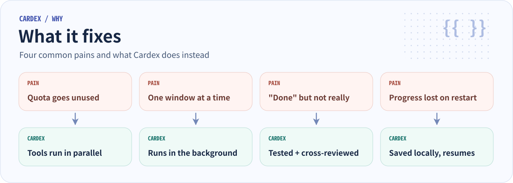
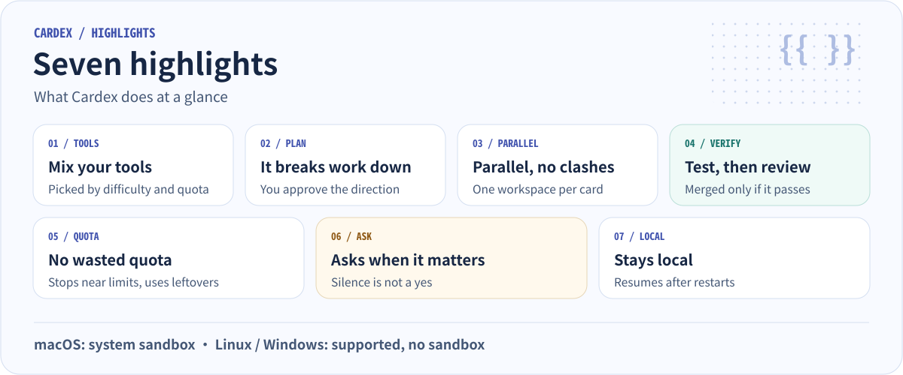
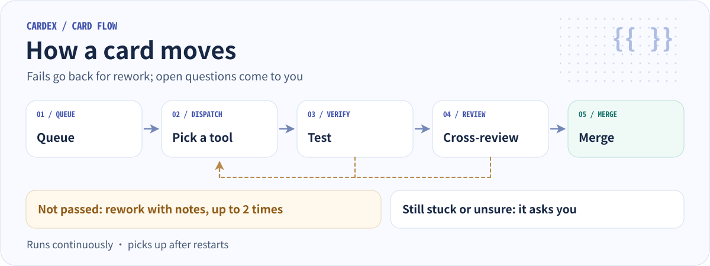

# Cardex

**Turn the AI coding tools you already pay for into one crew: you set the goal and make the calls; Cardex splits the work, dispatches it, checks it, and merges it.**

[中文](README.md) · **English** · [Install](#install) · [Supported tools](#supported-tools) · [Upgrade from V1](docs/v2/upgrade-from-v1.md) · [Download](https://github.com/OttoPrua/Cardex/releases/latest)


## What it fixes



The scheduler and board never call a model; the work runs on your own subscriptions or APIs.

## Highlights



- **Mix your tools**: Claude Code, Codex, Grok Build, Cursor, Kimi, OpenCode, Antigravity, picked by difficulty, capability, and quota; `route explain` says why.
- **Small jobs as cards, big ones split for you**: manual objectives run only your cards; automatic ones survey the repo, design, and split, starting only after you approve the direction.
- **Parallel without clashes**: each card works in its own workspace; edits to the same function queue up.
- **Test, review, then merge**: it checks real diffs and test results, not claims; code cards are reviewed by a different model family.
- **No wasted quota**: stops dispatching near a limit, and uses leftovers on backlog before a reset.
- **Asks when it matters**: decisions only you can make stop for your answer; silence is not a yes. Rework is capped at 2 tries by default.
- **Local and safe**: data stays on your machine, code in Git; on macOS executors run in a system sandbox and cannot push.

## How it works



`cardex serve` loops in the background: reconcile → settle finished work → advance objectives → merge → dispatch → send open questions.

- **A card**: pick a tool → verify → review → merge queue; failures go back with notes.
- **Automatic objectives**: add a design loop first; cards are split after you confirm the direction.
- **Merging**: one card at a time per objective, retested before merging; conflicts or red tests get a fix card. The main branch waits for your OK, and nothing is pushed for you.
- **Resilience**: one failing card doesn't block others; restarting the scheduler doesn't interrupt running executors.

<details>
<summary>More: browser testing, goal mode</summary>

- **Browser testing**: when needed, Cardex starts a localhost-only Chrome for the executor and cleans up afterwards.
- **Goal mode**: the native `/goal` of Grok Build, Kimi Code, and Cursor can drive a card for a long stretch; results still go through verify, review, and merge.

</details>

## Install

**Recommended**: paste this into a Codex or Hermes session that can operate your computer.

```text
Help me install and configure Cardex in this conversation. Download it from
https://github.com/OttoPrua/Cardex/releases/latest (or continue in the extracted folder with go.mod).
Read docs/v2/guide.md and skills/cardex-dispatch/SKILL.md. If this machine already has Cardex V1 data,
read docs/v2/upgrade-from-v1.md first. Then guide me step by step:
1. Confirm the management session, host, and data directory; install and run doctor.
2. List the execution CLIs you find, ask which subscriptions or APIs I want, and set up auth inside
   each tool (no keys pasted into chat).
3. Recommend T1–T3 models, a different model family for review, and quota reserves; save only after
   I confirm, then rerun doctor.
4. Recommend a manual or automatic objective, show the first card and its acceptance check, and ask
   before starting the scheduler.
```

**Manual**: download the package for your platform from [Releases](https://github.com/OttoPrua/Cardex/releases/latest), or build from source (Git + Go 1.24+):

```sh
git clone https://github.com/OttoPrua/Cardex.git && cd Cardex
go build -o ./cardex ./cmd/cardex && ./cardex --home "$HOME/.cardex-demo" doctor
```

A fresh `doctor` reporting missing channels or model placement is expected; continue with [the first objective](#run-a-first-objective).

| Platform | Support |
| --- | --- |
| macOS | Full, executors run in a seatbelt sandbox |
| Linux | Runs, no sandbox |
| Windows (amd64 / arm64) | Runs, no sandbox; needs `sh` from Git for Windows |

## Supported tools

| Coding tool | runner | How it connects |
| --- | --- | --- |
| Claude Code | `claude` | CLI login, or an Anthropic Messages compatible service |
| Codex CLI | `codex` | Signed-in account, or a Responses compatible provider |
| Grok Build | `grok` | Grok CLI account |
| Cursor Agent | `cursor` | Models available to your Cursor account |
| OpenCode | `opencode` | A configured `provider/model` |
| Kimi CLI | `kimi` | Kimi CLI account |
| Antigravity | `agy` | Antigravity CLI |

Cardex only passes the model ID to a signed-in tool; it does not translate protocols.

## Run a first objective


Using Codex to write and Claude to review:

```sh
export CARDEX_HOME="$HOME/.cardex-demo"
./cardex project add --id demo --repo /path/to/repo --test-cmd 'go test ./...'
./cardex channel set --id my-codex --runner codex --model 'YOUR_AUTHOR_MODEL_ID' --concurrency 1
./cardex channel set --id my-claude --runner claude --model 'YOUR_REVIEW_MODEL_ID' --concurrency 1
./cardex channel check
```

Add an initial model placement to `$CARDEX_HOME/config.json` (example below), then:

```sh
./cardex objective add --id first-change --project demo --mode manual \
  --title 'Fix export notes' --origin 'codex:YOUR_THREAD_ID'
./cardex card add --objective first-change --kind dev --tier T2 \
  --title 'Add export examples' --body 'Update the export docs, keep behavior, and run the project tests'
./cardex serve --addr 127.0.0.1:0
```

Open the printed address to follow progress; debug with `card show ID` and `route explain ID`.

> ⚠️ The board has **no authentication**. Bind it to localhost or a private address such as Tailscale; never expose `0.0.0.0` to the internet.

<details>
<summary>Initial model placement example</summary>

Model IDs must match the channels. T1 fact checks, T2 routine development, T3 design and review.

```json
{
  "positioning": [
    {"id": "starter-dev", "model": "YOUR_AUTHOR_MODEL_ID", "family": "gpt",
     "tiers": ["T1", "T2"], "capabilities": [], "preference": 1},
    {"id": "starter-review", "model": "YOUR_REVIEW_MODEL_ID", "family": "claude",
     "tiers": ["T3"], "capabilities": [], "preference": 1}
  ]
}
```

Update it later with `positioning proposals` / `positioning approve`.

</details>

**Docs**: [Guide](docs/v2/guide.md) · [Agent dispatch guide](docs/v2/agent-guide.md) · [Design](docs/v2/design.md) · [Dispatch skill](skills/cardex-dispatch/SKILL.md) · [Upgrade from V1](docs/v2/upgrade-from-v1.md)

## License

[PolyForm Noncommercial 1.0.0](LICENSE): free for personal use, study, research, and nonprofits; for commercial use, [open an issue](https://github.com/OttoPrua/Cardex/issues) describing it. Not an OSI open-source license; releases before 2026-08-03 (up to `b1ed92b`) remain MIT.

## Thanks

Cardex is shared in the [LINUX DO](https://linux.do) community. Thanks for all the feedback.
