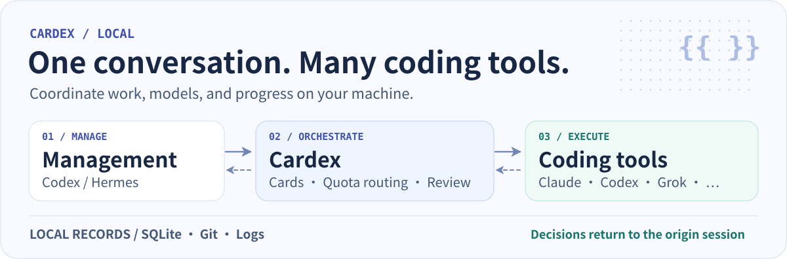
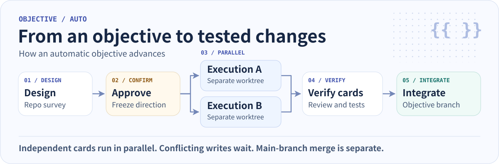

# Cardex

**Manage a goal in one conversation and let multiple AI coding tools work together to deliver it.**

[中文](README.md) · **English** · [Install](#install-and-get-started) · [Supported tools](#tools-and-connection-options) · [Download source](https://github.com/OttoPrua/Cardex/releases/tag/v2.0.0)



Cardex runs on your machine. Set goals and make key decisions in a **Codex or Hermes management session**. Cardex plans and schedules the work, and each coding tool uses its own subscription or API credentials. Objectives, cards, attempts, and decisions live in local SQLite; code stays in Git, and execution and acceptance logs stay on the machine. The management conversation can pause without losing saved work.

## Install and get started

**One-message setup (recommended): paste this into a Codex or Hermes session that can operate your computer.** A cloud session needs access to the Cardex host first. If you have already downloaded the source, give the agent the extracted folder and continue from there.

```text
Help me install and configure Cardex in this conversation. If I already downloaded the source,
start in the extracted directory containing go.mod. Otherwise get the source from
https://github.com/OttoPrua/Cardex/releases/tag/v2.0.0.
Read docs/v2/guide.md and skills/cardex-dispatch/SKILL.md, then guide me here:
1. Identify the management session and host, and confirm the data directory with me.
   Build from source and run doctor.
2. Tell me which execution CLIs you found and ask which subscriptions or APIs I want to use.
   Set up authentication in the tool itself. Separate installed, authenticated, and available models.
   I do not need to paste keys into chat.
3. Recommend T1–T3 models, a different model family for review, and quota reserves for my work.
   Explain the choices and let me accept or adjust them. Save after confirmation and rerun doctor.
4. Recommend a manual or automatic objective and show the first card and its acceptance check.
   Ask me before starting the scheduler or running work.
```

**Start manually after the first download** (macOS shell; Git and Go 1.24+ required):

1. Download **Source code (zip)** or **tar.gz** from the [download page](https://github.com/OttoPrua/Cardex/releases/tag/v2.0.0). Extract it and open the directory containing `go.mod` in a terminal.
2. Paste this one command to build locally and check a separate data directory for your first run:

```sh
go build -o ./cardex ./cmd/cardex && ./cardex --home "$HOME/.cardex-demo" doctor
```

3. Once the command finishes, you can configure Cardex. A fresh data directory reports missing channels or model placement; continue in the same management session or follow [the first objective](#run-a-first-objective) below.

The download page provides a source archive. These examples use `~/.cardex-demo` as the data directory. You can choose another location with `--home` or `CARDEX_HOME`. System-level write isolation for executors is currently implemented on macOS.

[User guide](docs/v2/guide.md) · [Dispatch skill for management sessions](skills/cardex-dispatch/SKILL.md)

## Tools and connection options

| Execution tool | Runner | How to connect |
| --- | --- | --- |
| Claude Code | `claude` | Use the CLI login or connect an Anthropic Messages compatible service through Claude Code |
| Codex CLI | `codex` | Use the CLI account or a configured Responses compatible provider |
| Grok Build | `grok` | Use the Grok CLI account and its available models |
| Cursor Agent | `cursor` | Use models available to your Cursor account |
| OpenCode | `opencode` | Use a configured `provider/model`, such as OpenCode Go or a custom compatible service |
| Kimi CLI | `kimi` | Reuse the Kimi CLI account and model configuration |
| Antigravity | `agy` | Use the Antigravity CLI and its available models |

**Subscriptions, metered APIs, and compatible gateways connect through the execution tool.** For example, use Claude Code for Anthropic Messages, Codex CLI for OpenAI Responses, or a matching OpenCode provider for OpenAI Chat Completions. Cardex passes the configured model ID to the tool. Protocol, model, reasoning effort, and quota support depend on the CLI and account. OpenCode is the tool; OpenCode Go is a service plan.

The code also retains [Claude compatible engine profiles](internal/runner/engines.go) for Kimi Code, GLM, MiniMax, MiMo, OpenCode Go, and Ollama Cloud. A Claude channel uses a profile when its `engine_profile` is set. The current `channel set` command does not set that binding; on a fresh install, you can configure the service in its execution CLI first.

## What Cardex helps you do

- **Manage development in one conversation.** Add one card for a small change, or let Cardex survey the repository, plan, and split up a larger goal. You make the decisions that need your input.
- **Find a suitable model for each card.** Routing considers the task tier, model capabilities, channel health, concurrency, and estimated quota. Use `route explain` to see why a model was selected.
- **Run independent work in parallel and test it before integrating.** Each attempt gets its own Git worktree. Cards with conflicting write claims wait. Development cards get a review from a different model family, and project tests must pass before the objective branch advances.
- **Pick up where you left off.** Cards, results, attempt logs, and code stay on your machine. A later attempt can continue from the card branch with saved context and review feedback.

**Eligible quota or authentication failures can be routed again.** A new attempt can pick up from the saved card branch. If no suitable channel is available, Cardex waits or asks; an explicit executor refusal does not silently switch tools.



> **Use a manual objective for small changes and an automatic objective for multi-step work.** `manual` processes the cards you add without generating design or planning cards. `auto` advances the design tree and dependencies. In the default `safe` mode, you confirm direction and module freezes. `fast` can freeze ready modules and details automatically; the direction still needs your approval. Integrating into an objective branch and merging into the project’s main branch are separate steps. Push and release decisions remain separate.

## Run a first objective

Log in or configure the API in each execution CLI first. This example uses Codex for development and Claude for review. You can substitute other model families you have configured. Replace the repo path, model IDs, and test command:

```sh
export CARDEX_HOME="$HOME/.cardex-demo"
./cardex project add --id demo --repo /path/to/repo --test-cmd 'go test ./...'
./cardex channel set --id my-codex --runner codex --model 'YOUR_AUTHOR_MODEL_ID' --concurrency 1
./cardex channel set --id my-claude --runner claude --model 'YOUR_REVIEW_MODEL_ID' --concurrency 1
./cardex channel check
./cardex --json positioning show
```

If there is no approved placement table, add your confirmed initial `positioning` to `config.json` in the data directory: model ID, model family, tiers, and capabilities. Review later changes with `positioning proposals` and apply one with `positioning approve ID`. Set quota windows and reserves to match your account, then run `doctor` again. For example, use T1 for fact checks, T2 for routine development, and T3 for design and review. Choose tiers based on capability and provide a different model family for review.

<details>
<summary>Example starting model placement</summary>

Merge this into your `config.json`, preserving other settings. Match the model IDs to their channels. Check the families and tiers when substituting models.

```json
{
  "positioning": [
    {
      "id": "starter-dev",
      "model": "YOUR_AUTHOR_MODEL_ID",
      "family": "gpt",
      "tiers": ["T1", "T2"],
      "capabilities": [],
      "preference": 1
    },
    {
      "id": "starter-review",
      "model": "YOUR_REVIEW_MODEL_ID",
      "family": "claude",
      "tiers": ["T3"],
      "capabilities": [],
      "preference": 1
    }
  ]
}
```

</details>

Once configured, start with one change that has a clear acceptance check. Replace `YOUR_THREAD_ID` with the management session’s ID, or use `hermes:PROFILE/SESSION` for Hermes.

```sh
./cardex objective add --id first-change --project demo --mode manual \
  --title 'Clarify export documentation' --origin 'codex:YOUR_THREAD_ID'
./cardex card add --objective first-change --kind dev --tier T2 \
  --title 'Add an export example' --body 'Update the docs, preserve behavior, and run the project tests'
./cardex serve --addr 127.0.0.1:0
```

`serve` starts the scheduler and read-only board together, so start it when you are ready to dispatch ready cards. Open the printed address to see objectives, cards, attempts, channels, and decisions. Use `--origin` or `CARDEX_ORIGIN` to associate work with the management session, and [configure notifications](docs/v2/guide.md#配置通知) to receive decisions there. Use `card show ID` and `route explain ID` to inspect a dispatch, and `--json question show ID` to see the available answers.

> The board is read-only but has **no authentication**, and it shows objectives, cards, and questions. For remote viewing, bind to localhost or a private network address such as Tailscale; do not expose `0.0.0.0` to the public internet.

[Design notes](docs/v2/design.md) · [PolyForm Noncommercial 1.0.0](LICENSE)
