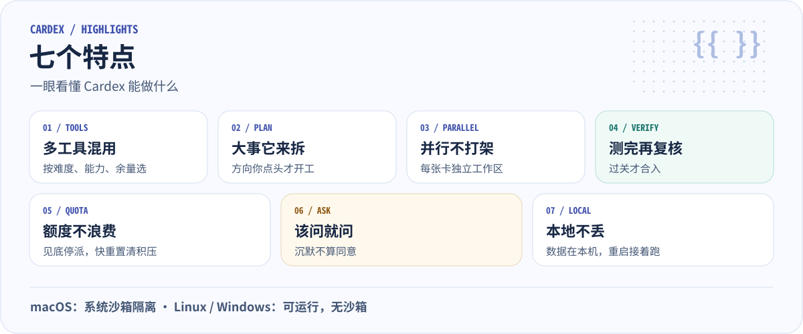
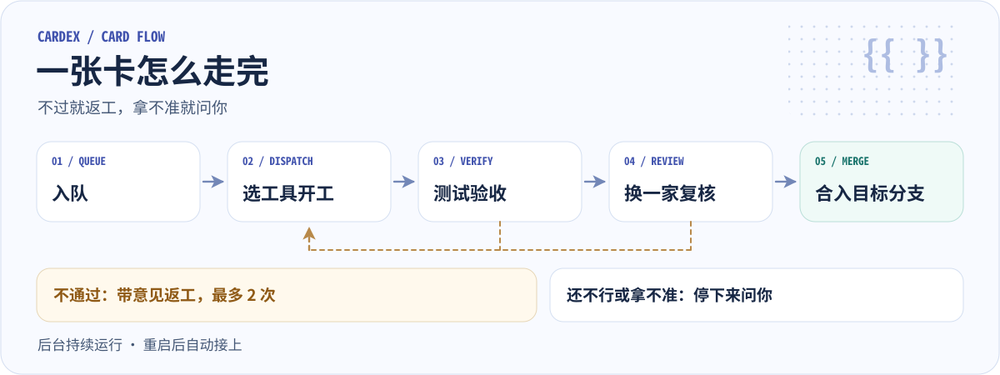

# Cardex

**Cardex 是装在你自己电脑上的「AI 编程包工头」。你只管定目标、拍板，它负责把活拆开、派给合适的 AI 编程工具去做、检查质量，再把合格的成果合进代码里。**

**中文** · [English](README.en.md) · [安装](#安装) · [支持的工具](#支持的工具) · [从 V1 升级](docs/v2/upgrade-from-v1.md) · [下载源码](https://github.com/OttoPrua/Cardex/releases/tag/v2.0.0)


现在很多人同时订阅了好几家 AI 编程工具，额度却常常用不完：人一次只能盯一个窗口，做完的东西还要自己检查、合并。Cardex 把这些工具当成一支施工队——记住每家还剩多少额度、擅长什么，把任务排好队、同时开工；每份活都在独立的工位里做，做完先自动测试，再换另一家模型复核，过关才合入。中途有需要你决定的事，它会问你，不会自己瞎猜。

调度和看板本身不花模型额度，真正干活用的是你各家自己的订阅或 API。进度存在你这台电脑上，对话关了、电脑重启了，活也不会丢。

## 它有什么特点



**多种工具一起用。** Claude Code、Codex、Grok Build、Cursor、Kimi、OpenCode、Antigravity 都能接入。Cardex 按任务难度、工具能力和剩余额度，挑选最合适的那一个，并能用 `route explain` 说清楚为什么选它。调度和看板不调用模型，也不做协议转换，只把模型 ID 交给已经登录好的执行工具。

**简单的事你写工单，复杂的事它帮你拆开。** 手动目标只跑你加的卡，适合目标已经很清楚的小改动。自动目标会先摸清仓库、做设计，再拆成一张张开发卡；关键方向一定先问你，你点头后才开工。设计和开发可以交错推进，不是全部设计完才动手。

**多张卡同时开工，互不打架。** 每份活都在一份独立的代码副本里做，改坏了只影响这一份。会改到同一个函数的卡会自动排队；改同一文件、不同部分的可以并行。

**不听「我做完了」，先测再换一家复核，合格才合入。** 执行器干完后，Cardex 看实际改动、跑验收测试，而不是听它口头汇报。代码类的卡还要换另一家（不同模型族）来复核。通过的卡一张张合进这个目标的汇总分支，合之前再测一遍；全部完成后，经你同意才合进主分支，而且不会擅自把代码推到远端。

**额度替你记账：留下红线，余量也不浪费。** 某个工具额度快到底，就不再自动把活派给它。快到重置时间还剩不少，就顺手做点积压的小活，免得额度过期作废。某条渠道撞到额度或认证出问题，会先记下、换一条合适的接着做，不会悄悄乱换工具。

**拿不准的事一定问你；返工有上限，反复失败会刹车。** 只有你能定的事，它会停下来给出选项。你不回就不往下走，绝不会把沉默当成同意。测试没过或复核不满意，会带着意见自动返工，默认最多 2 次；再修不好，就来问你怎么办。某块活反复失败，或花费碰到上限，就暂停那一块并提问，别的部分照常推进。

**装在你自己的电脑上，对话关了进度也不丢。** 目标、卡片、尝试和决策存在本地数据库里，代码在 Git 里。本机有一个只读看板，能看当前工作、渠道余量和每张卡的日志。有问题要拍板时，会先通知到创建目标的那个管理会话，也可以发到你登记的接收端，并总会写进本地收件箱。

在安全方面：macOS 上，执行器跑在系统自带的沙箱里，只能改自己的工作区和少数临时目录，碰不到电脑别处；工作区里还装了拒绝推送的钩子，执行器推不了代码。凭据不会写进提示词或仓库。Linux 可以构建和运行，但没有这层沙箱。Windows 也可以构建和运行，同样没有系统沙箱。

## 它是怎么工作的

Cardex 不是跑一次就结束的脚本，而是几个循环叠在一起，由 `cardex serve` 在后台不停转。



最外层是**调度主循环**。每一轮先对账（有没有已经掉线的活）、给做完的尝试下结论，再推进目标、按队列合并、派发新活，最后把需要你拍板的问题送出去。某一步出错只记下来，后面的步骤照跑；一张卡或一个目标出问题，不会挡住别人。已经在跑的执行器，也不会因为调度重启而被打断。

**每一张卡**都走同一条路：入队以后，按难度选工具，在独立工位里开工；干完后收割验收。通过了，代码类的卡会换一家复核，合格就进入合并队列；测试失败或复核不满意就返工；碰到拒答、越界，或修了两次还不行，就停下来问你。你回答之后，下一轮再按你的选择继续。

如果你建的是**自动目标**，前面还会多一层设计循环：先盘点仓库，再写设计；「查一下就知道」的问题会交给便宜模型并行去查，方向层永远要你确认，确认后才拆卡开工。开发和设计可以交错进行。全部完成后，会问你是否合进主分支。自动目标的这条路径，在下面「跑通第一个目标」里还有一张图。

**合并**按目标排队，同一目标一次只合一张，不同目标互不影响。合之前在临时工作区再跑一遍验收和项目测试；有冲突就派人去变基，测试变红就派人去修。合进的是这个目标的汇总分支，进主分支要等你点头。

另外两件可以按需使用的事：需要打开网页测试时，Cardex 会先在本机启动一个只监听本机地址的 Chrome，执行器连上去就能用，结束时关掉并清掉临时目录。如果希望某个任务长时间自主推进，可以给卡加上目标模式要求——**目前 Grok Build、Kimi Code 和 Cursor 的原生 `/goal` 都能接这类活**，Cardex 在外面看它的状态，完成后仍然走普通的验收、复核和合并。

电脑或调度重启之后，对账会先检查还在「运行中」的尝试：相关进程还活着就让它继续；已经没人管的，收拾干净再交给收割，不会把活悄悄丢掉。

## 安装

**推荐：把这段发给能操作这台电脑的 Codex 或 Hermes 会话。**

```text
请在这个对话里帮我安装并配置 Cardex。源码从 https://github.com/OttoPrua/Cardex/releases/tag/v2.0.0 获取
（已下载就从包含 go.mod 的目录继续）。阅读 docs/v2/guide.md 和 skills/cardex-dispatch/SKILL.md；
若这台机器上已有 Cardex V1 数据，先读 docs/v2/upgrade-from-v1.md。然后逐步引导我：
1. 确认管理会话、运行主机和数据目录，从源码构建并运行 doctor。
2. 列出检测到的执行 CLI，问我要接入哪些订阅或 API，在工具内完成认证（不要把密钥发到对话里）。
3. 按我的账户和额度推荐 T1–T3 模型、不同模型族的复核和额度红线，我确认后再保存并重跑 doctor。
4. 推荐手动或自动目标，展示第一张卡和验收方式，我确认后再启动调度。
```

**手动**（需要 Git 和 Go 1.24+）：

```sh
git clone https://github.com/OttoPrua/Cardex.git && cd Cardex
go build -o ./cardex ./cmd/cardex && ./cardex --home "$HOME/.cardex-demo" doctor
```

首次 `doctor` 提示缺渠道或模型定位是正常的，接着按[第一个目标](#跑通第一个目标)配置。数据目录用 `--home` 或 `CARDEX_HOME` 指定。

> **平台：** macOS 完整支持，执行器在 seatbelt 沙箱里运行。Linux 可以构建和运行，但执行器不经沙箱。Windows（amd64 / arm64）可以构建和运行，执行器同样不经沙箱，需要 Git for Windows 提供的 `sh`。

## 支持的工具

| 执行工具 | runner | 接入方式 |
| --- | --- | --- |
| Claude Code | `claude` | CLI 登录，或 Anthropic Messages 兼容服务 |
| Codex CLI | `codex` | 已登录账户，或 Responses 兼容 provider |
| Grok Build | `grok` | Grok CLI 账户 |
| Cursor Agent | `cursor` | Cursor 账户可用模型 |
| OpenCode | `opencode` | 已配置的 `provider/model`（如 OpenCode Go、Chat Completions 兼容服务） |
| Kimi CLI | `kimi` | Kimi CLI 账户 |
| Antigravity | `agy` | Antigravity CLI |

订阅、按量 API 和兼容网关都经由对应的执行工具接入；Cardex 只传模型 ID，不做协议转换。

## 跑通第一个目标


以 Codex 开发、Claude 复核为例，替换仓库路径、模型 ID 和测试命令：

```sh
export CARDEX_HOME="$HOME/.cardex-demo"
./cardex project add --id demo --repo /path/to/repo --test-cmd 'go test ./...'
./cardex channel set --id my-codex --runner codex --model 'YOUR_AUTHOR_MODEL_ID' --concurrency 1
./cardex channel set --id my-claude --runner claude --model 'YOUR_REVIEW_MODEL_ID' --concurrency 1
./cardex channel check
```

然后在 `$CARDEX_HOME/config.json` 写入初始模型定位（见下方示例），之后用 `positioning proposals` / `positioning approve` 更新。

```sh
./cardex objective add --id first-change --project demo --mode manual \
  --title '修正导出说明' --origin 'codex:YOUR_THREAD_ID'
./cardex card add --objective first-change --kind dev --tier T2 \
  --title '补齐导出示例' --body '更新导出文档，保留现有行为，并运行项目测试'
./cardex serve --addr 127.0.0.1:0
```

`serve` 同时启动调度和只读看板，打开它打印的地址查看进度。排查派发用 `card show ID` 和 `route explain ID`。

> 看板**没有鉴权**。远程查看请绑定本机或 Tailscale 这类私有地址，不要用 `0.0.0.0` 暴露到公网。

<details>
<summary>初始模型定位示例</summary>

合并进 `config.json`，模型 ID 要和渠道登记的一致。T1 适合事实核对，T2 常规开发，T3 设计与复核。

```json
{
  "positioning": [
    {"id": "starter-dev", "model": "YOUR_AUTHOR_MODEL_ID", "family": "gpt",
     "tiers": ["T1", "T2"], "capabilities": [], "preference": 1},
    {"id": "starter-review", "model": "YOUR_REVIEW_MODEL_ID", "family": "claude",
     "tiers": ["T3"], "capabilities": [], "preference": 1}
  ]
}
```

</details>

[使用指南](docs/v2/guide.md) · [Agent 派发指引](docs/v2/agent-guide.md) · [设计说明](docs/v2/design.md) · [派发 Skill](skills/cardex-dispatch/SKILL.md) · [从 V1 升级](docs/v2/upgrade-from-v1.md)

## 许可

[PolyForm Noncommercial 1.0.0](LICENSE)：个人自用、学习研究和非营利机构可直接使用；公司生产使用、承接付费项目或作为产品服务的一部分需要授权，[开 issue](https://github.com/OttoPrua/Cardex/issues) 说明用途即可。这不是 OSI 开源许可；2026-08-03 之前的版本（截至 `b1ed92b`）仍为 MIT。

## 致谢

本项目在 [LINUX DO](https://linux.do) 社区分享，感谢佬友们的反馈。
