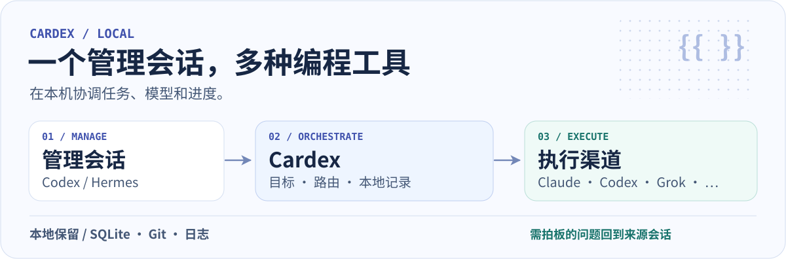
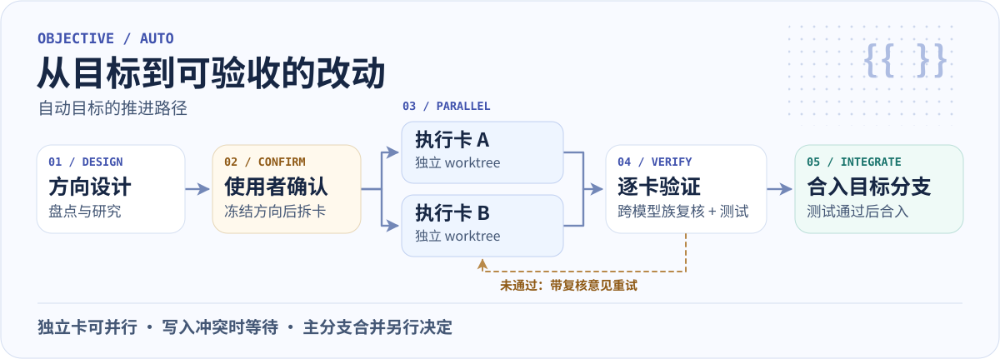

# Cardex

**在一个管理对话里定目标，让多个 AI 编程工具协作交付。**

**中文** · [English](README.en.md) · [安装](#安装) · [支持的工具](#支持的工具) · [从 V1 升级](docs/v2/upgrade-from-v1.md) · [下载源码](https://github.com/OttoPrua/Cardex/releases/tag/v2.0.0)



Cardex 是跑在你机器上的开发编排器。你在 **Codex 或 Hermes 管理会话**里定目标、回答关键问题；Cardex 负责拆卡、选模型、派发、复核和合入，执行工具用各自的订阅或 API。调度和看板本身不调用模型。

- **复用已有订阅和 API。** Claude Code、Codex、Grok、Cursor、Kimi、OpenCode、Antigravity 都能接入，按档位、能力和剩余额度选路，`route explain` 说明每次为什么选它。
- **简单的事一张卡，复杂的事自动推进。** 手动目标只跑你加的卡；自动目标做盘点、设计和拆卡，只在需要拍板时问你。
- **并行执行，验证后再合入。** 每次尝试用独立 worktree，写入冲突的卡排队；由不同模型族复核，项目测试通过才进目标分支。
- **对话可以停，进度不丢。** 目标、卡片、尝试和决策存在本地 SQLite，代码在 Git。额度或认证出问题时从卡分支接着做，没有合适渠道就等待或提问，不会静默换工具。

## 安装

**推荐：把这段发给能操作这台电脑的 Codex 或 Hermes 会话。**

```text
请在这个对话里帮我安装并配置 Cardex。源码从 https://github.com/OttoPrua/Cardex/releases/tag/v2.0.0 获取
（已下载就从包含 go.mod 的目录继续）。阅读 docs/v2/guide.md 和 skills/cardex-dispatch/SKILL.md；
若这台机器上已有 Cardex V1 数据，先读 docs/v2/upgrade-from-v1.md。然后逐步引导我：
1. 确认管理会话、运行主机和数据目录，从源码构建并运行 doctor。
2. 列出检测到的执行 CLI，问我要接入哪些订阅或 API，在工具内完成认证（不要把密钥发到对话里）。
3. 按我的账户和额度推荐 T1–T3 模型、不同模型族的复核和额度红线，我确认后再保存并重跑 doctor。
4. 推荐手动或自动目标，展示第一张卡和验收方式，我确认后再启动调度。
```

**手动**（需要 Git 和 Go 1.24+）：

```sh
git clone https://github.com/OttoPrua/Cardex.git && cd Cardex
go build -o ./cardex ./cmd/cardex && ./cardex --home "$HOME/.cardex-demo" doctor
```

首次 `doctor` 提示缺渠道或模型定位是正常的，接着按[第一个目标](#跑通第一个目标)配置。数据目录用 `--home` 或 `CARDEX_HOME` 指定。

> **平台：** macOS 完整支持，执行器在 seatbelt 沙箱里运行。Linux 可以构建和运行，但执行器不经沙箱。V2 暂不支持 Windows。

## 支持的工具

| 执行工具 | runner | 接入方式 |
| --- | --- | --- |
| Claude Code | `claude` | CLI 登录，或 Anthropic Messages 兼容服务 |
| Codex CLI | `codex` | 已登录账户，或 Responses 兼容 provider |
| Grok Build | `grok` | Grok CLI 账户 |
| Cursor Agent | `cursor` | Cursor 账户可用模型 |
| OpenCode | `opencode` | 已配置的 `provider/model`（如 OpenCode Go、Chat Completions 兼容服务） |
| Kimi CLI | `kimi` | Kimi CLI 账户 |
| Antigravity | `agy` | Antigravity CLI |

订阅、按量 API 和兼容网关都经由对应的执行工具接入；Cardex 只传模型 ID，不做协议转换。

## 跑通第一个目标



以 Codex 开发、Claude 复核为例，替换仓库路径、模型 ID 和测试命令：

```sh
export CARDEX_HOME="$HOME/.cardex-demo"
./cardex project add --id demo --repo /path/to/repo --test-cmd 'go test ./...'
./cardex channel set --id my-codex --runner codex --model 'YOUR_AUTHOR_MODEL_ID' --concurrency 1
./cardex channel set --id my-claude --runner claude --model 'YOUR_REVIEW_MODEL_ID' --concurrency 1
./cardex channel check
```

然后在 `$CARDEX_HOME/config.json` 写入初始模型定位（见下方示例），之后用 `positioning proposals` / `positioning approve` 更新。

```sh
./cardex objective add --id first-change --project demo --mode manual \
  --title '修正导出说明' --origin 'codex:YOUR_THREAD_ID'
./cardex card add --objective first-change --kind dev --tier T2 \
  --title '补齐导出示例' --body '更新导出文档，保留现有行为，并运行项目测试'
./cardex serve --addr 127.0.0.1:0
```

`serve` 同时启动调度和只读看板，打开它打印的地址查看进度。排查派发用 `card show ID` 和 `route explain ID`。

> 看板**没有鉴权**。远程查看请绑定本机或 Tailscale 这类私有地址，不要用 `0.0.0.0` 暴露到公网。

<details>
<summary>初始模型定位示例</summary>

合并进 `config.json`，模型 ID 要和渠道登记的一致。T1 适合事实核对，T2 常规开发，T3 设计与复核。

```json
{
  "positioning": [
    {"id": "starter-dev", "model": "YOUR_AUTHOR_MODEL_ID", "family": "gpt",
     "tiers": ["T1", "T2"], "capabilities": [], "preference": 1},
    {"id": "starter-review", "model": "YOUR_REVIEW_MODEL_ID", "family": "claude",
     "tiers": ["T3"], "capabilities": [], "preference": 1}
  ]
}
```

</details>

[使用指南](docs/v2/guide.md) · [Agent 派发指引](docs/v2/agent-guide.md) · [设计说明](docs/v2/design.md) · [派发 Skill](skills/cardex-dispatch/SKILL.md) · [从 V1 升级](docs/v2/upgrade-from-v1.md)

## 许可

[PolyForm Noncommercial 1.0.0](LICENSE)：个人自用、学习研究和非营利机构可直接使用；公司生产使用、承接付费项目或作为产品服务的一部分需要授权，[开 issue](https://github.com/OttoPrua/Cardex/issues) 说明用途即可。这不是 OSI 开源许可；2026-08-03 之前的版本（截至 `b1ed92b`）仍为 MIT。

## 致谢

本项目在 [LINUX DO](https://linux.do) 社区分享，感谢佬友们的反馈。
