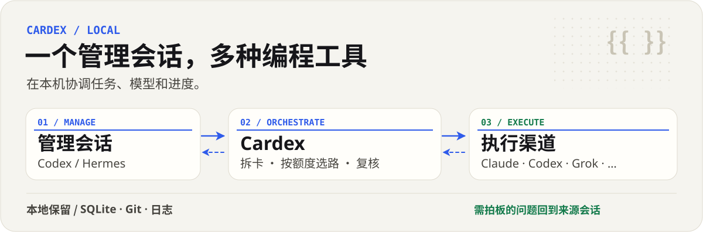
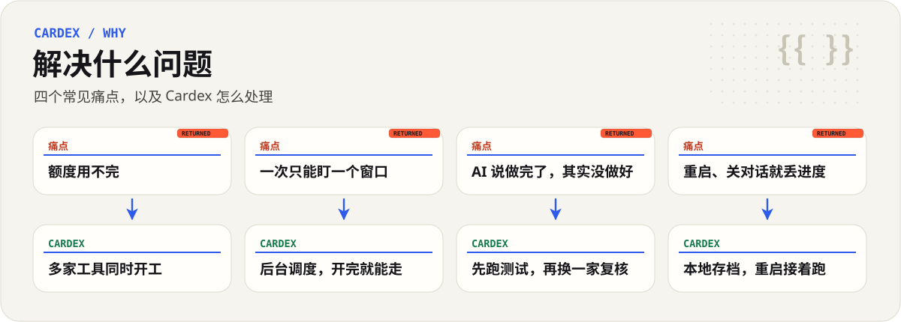
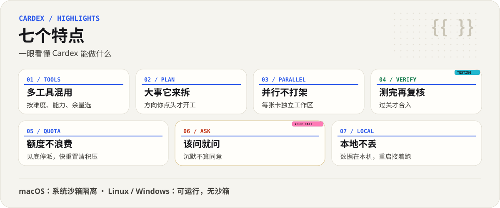
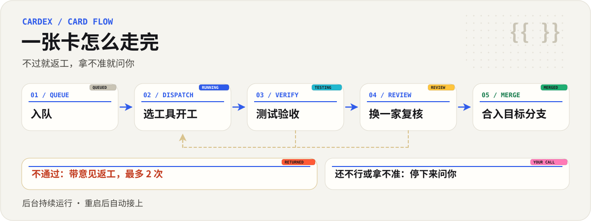
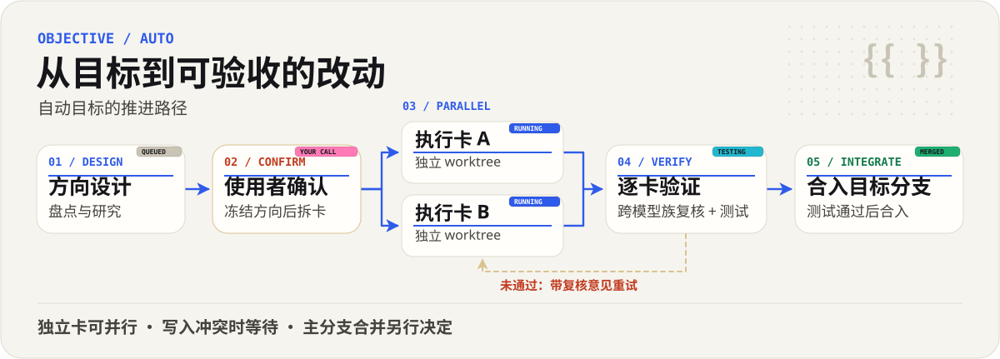

# Cardex

**把你订阅的多家 AI 编程工具组成一支施工队：你定目标、拍板，Cardex 负责拆活、派活、验收、合入。**

**中文** · [English](README.en.md) · [安装](#安装) · [支持的工具](#支持的工具) · [从 V1 升级](docs/v2/upgrade-from-v1.md) · [下载](https://github.com/OttoPrua/Cardex/releases/latest)



## 解决什么问题



调度和看板本身不花模型额度，干活用的是你自己的订阅或 API。

## 特点



- **多工具混用**：Claude Code、Codex、Grok Build、Cursor、Kimi、OpenCode、Antigravity，按难度、能力和余量挑一个；`route explain` 说明为什么选它。
- **小事写卡，大事它拆**：手动目标只跑你加的卡；自动目标先读仓库、做设计、拆卡，方向要你点头才开工。
- **并行不打架**：每张卡在独立工作区里做；改同一函数的自动排队。
- **先测、再复核、再合入**：看实际改动和测试结果，不听口头汇报；代码卡由另一家模型复核。
- **额度不浪费**：快见底就不再派；快重置还有余量，就顺手清积压。
- **该问就问**：需要你定的事一定停下来给选项，沉默不算同意；返工默认最多 2 次，再不行就问你。
- **本地、安全**：数据在本机，代码在 Git；macOS 上执行器跑在系统沙箱里，且推不了代码。

## 工作方式



`cardex serve` 在后台循环：对账 → 给做完的活下结论 → 推进目标 → 合并 → 派新活 → 送出待你拍板的问题。

- **一张卡**：选工具开工 → 验收 → 复核 → 进合并队列；不过就带意见返工。
- **自动目标**：多一层设计循环，方向确认后才拆卡，设计和开发可交错。
- **合并**：同一目标一次合一张，合前再跑测试；有冲突或变红就派人修。进主分支要你同意，不会擅自推远端。
- **容错**：某张卡出错不影响别的；调度重启不打断正在跑的执行器。

<details>
<summary>更多：网页测试、目标模式</summary>

- **网页测试**：需要时 Cardex 在本机启动只监听本机地址的 Chrome 给执行器用，结束后清理。
- **目标模式**：Grok Build、Kimi Code、Cursor 的原生 `/goal` 可以长时间自主推进一张卡，完成后仍走验收、复核、合并。

</details>

## 安装

**推荐**：把这段发给能操作这台电脑的 Codex 或 Hermes 会话。

```text
请在这个对话里帮我安装并配置 Cardex。从 https://github.com/OttoPrua/Cardex/releases/latest 下载
（已下载就从包含 go.mod 的目录继续）。阅读 docs/v2/guide.md 和 skills/cardex-dispatch/SKILL.md；
若这台机器上已有 Cardex V1 数据，先读 docs/v2/upgrade-from-v1.md。然后逐步引导我：
1. 确认管理会话、运行主机和数据目录，安装并运行 doctor。
2. 列出检测到的执行 CLI，问我要接入哪些订阅或 API，在工具内完成认证（不要把密钥发到对话里）。
3. 按我的账户和额度推荐 T1–T3 模型、不同模型族的复核和额度红线，我确认后再保存并重跑 doctor。
4. 推荐手动或自动目标，展示第一张卡和验收方式，我确认后再启动调度。
```

**手动**：从 [Releases](https://github.com/OttoPrua/Cardex/releases/latest) 下载对应平台的包，或从源码构建（Git + Go 1.24+）：

```sh
git clone https://github.com/OttoPrua/Cardex.git && cd Cardex
go build -o ./cardex ./cmd/cardex && ./cardex --home "$HOME/.cardex-demo" setup
```

`setup` 会找出已安装的 CLI、检查是否登录，并给出推荐渠道；确认后运行 `setup --yes` 写入渠道并生成一份推荐定位，再用 `positioning approve` 批准即可。想手动配置的，接着看[第一个目标](#跑通第一个目标)。

| 平台 | 支持情况 |
| --- | --- |
| macOS | 完整支持，执行器在 seatbelt 沙箱里运行 |
| Linux | 可运行，无沙箱 |
| Windows（amd64 / arm64） | 可运行，无沙箱，需要 Git for Windows 的 `sh` |

## 支持的工具

| 执行工具 | runner | 接入方式 |
| --- | --- | --- |
| Claude Code | `claude` | CLI 登录，或 Anthropic Messages 兼容服务 |
| Codex CLI | `codex` | 已登录账户，或 Responses 兼容 provider |
| Grok Build | `grok` | Grok CLI 账户 |
| Cursor Agent | `cursor` | Cursor 账户可用模型 |
| OpenCode | `opencode` | 已配置的 `provider/model` |
| Kimi CLI | `kimi` | Kimi CLI 账户 |
| Antigravity | `agy` | Antigravity CLI |

Cardex 只把模型 ID 交给已登录的工具，不做协议转换。

## 跑通第一个目标



以 Codex 开发、Claude 复核为例：

```sh
export CARDEX_HOME="$HOME/.cardex-demo"
./cardex project add --id demo --repo /path/to/repo --test-cmd 'go test ./...'
./cardex channel set --id my-codex --runner codex --model 'YOUR_AUTHOR_MODEL_ID' --concurrency 1
./cardex channel set --id my-claude --runner claude --model 'YOUR_REVIEW_MODEL_ID' --concurrency 1
./cardex channel check
```

生成并批准模型定位：`./cardex positioning propose`，再按提示 `./cardex positioning approve <id>`（也可以 `--file` 提交自己写的表，格式见下方示例）。然后：

```sh
./cardex objective add --id first-change --project demo --mode manual \
  --title '修正导出说明' --origin 'codex:YOUR_THREAD_ID'
./cardex card add --objective first-change --kind dev --tier T2 \
  --title '补齐导出示例' --body '更新导出文档，保留现有行为，并运行项目测试'
./cardex serve --addr 127.0.0.1:0
```

打开 `serve` 打印的地址看进度；排查用 `card show ID` 和 `route explain ID`。

看板顶部按「当前工作 / 模型与额度 / 历史」分区。「模型与额度」再分两个页签：

- **模型运行**：按实际选路汇总每个模型的并行路数、渠道和正在处理的卡；已配置但空闲的模型也保留。
- **渠道与额度**：显示执行器、订阅组、本地并发占用、原始渠道等级和本地额度窗口。并发上限为 0 表示不设本地上限，不是没有容量。

额度展示参考 [CodexBar](https://github.com/steipete/CodexBar/blob/main/docs/providers.md) 的渠道隔离、窗口/重置时间和未知值处理。CardeX 可以显式导入其供应商用量 JSON，但不启动 CodexBar、不读取供应商凭据，也不自动采集。未导入时显示 **unknown**；本地额度窗口单独标记，未配置上限、置信度不大于 0、无效比例或已过重置时间时也显示 unknown，不把耗时估算冒充订阅余额。同订阅组的数据不累加为总余额。

#### 导入供应商订阅用量（默认不采集）

```sh
# 只导入用户已授权的单个 provider、单个账号；不将原始 JSON 保存到 CardeX。
cardex channel import-usage --id my-codex-channel --provider codex --input /path/to/authorized-usage.json
```

命令只接受 CodexBar `usage --format json` 的单元素数组，支持 `--input -` 从标准输入读取。由用户把选定的供应商账号映射到已有渠道；CardeX 不保留账号邮箱、身份信息、诊断、原始错误或未知字段，**因此不会自动核验该账号与渠道是否相符**。有 `source_group` 的渠道共用该组的一份快照；未设置订阅组则仅属于当前渠道。不同账号应登记在不同订阅组中，不能把 Cursor 的 Grok 共享池登记为独立 Grok 账户余额。

仅在用户明确授权本地采集后，才由用户或获准的本地采集任务运行以下命令；CardeX 自己不会执行它，也不会替用户创建定时任务：

```sh
codexbar usage --provider codex --source cli --format json | cardex channel import-usage --id my-codex-channel --provider codex --input -
```

授权在 CodexBar/对应 CLI 中完成，**不应把 token、Cookie 或 API key 传给 CardeX**。多账号时先在 CodexBar 侧选择对应账号，避免 `--all-accounts`。原始输出可能包含身份和诊断，勿打印、提交或留在共享目录；CardeX 只落盘白名单字段到 `$CARDEX_HOME/subscription-usage/`（默认 `~/.cardex/subscription-usage/`），文件权限为 0600。

快照必须有供应商采集时间，**15 分钟内有效**；未来超出 1 分钟、已过重置时间、缺失比例、超出 0–100、非有限数、synthetic placeholder、`usageKnown: false` 或显式 `estimated`/`unknown` confidence 均显示 unknown。合法 0% 剩余仍显示 0%，不解释为缺测。兼容 CodexBar 省略 confidence 的原生响应，但仍严格校验来源、百分比和时间。采集失败的标准 error payload 会覆盖旧快照为 unknown；无效 JSON 被拒绝，已有快照仅在其原有效期内保留，并始终显示采集时间。页面的 5 秒刷新只重读本地快照，**不代表重新采集**。导入不修改渠道健康、本地 quota ledger 或路由权重。

六家来源审计基于 [CodexBar `1f6da9b`](https://github.com/steipete/CodexBar/tree/1f6da9bec44455288ddee5ef6f3617a803d8eb2a)，未用真实账号探测；“可导入”是对已有采集实现及其 JSON 来源的判断，不保证供应商私有接口持续稳定：

| 供应商 | 已有可靠采集路径 / 本次接受的 JSON `source` | 用户决定授权后如何取得 | 不混淆的边界 |
|---|---|---|---|
| [Codex / ChatGPT](https://github.com/steipete/CodexBar/blob/1f6da9bec44455288ddee5ef6f3617a803d8eb2a/docs/codex.md) | 官方 Codex app-server `account/rateLimits/read`：`codex-cli`；wham usage：`oauth` | 已登录 Codex CLI，或授权 CodexBar 复用 OAuth；CLI 模式 `--source cli` | 订阅窗口并非每模型独立余额；额外 `credits` 只按 credits 标记，不换算美元 |
| [Claude](https://github.com/steipete/CodexBar/blob/1f6da9bec44455288ddee5ef6f3617a803d8eb2a/docs/claude.md) | `/api/oauth/usage`：`oauth` | Claude Code OAuth 需 `user:profile`；CodexBar `--source oauth`；普通推理 key 不够 | 不接受 Admin API 组织 spend；本次不接受 PTY/web 兜底 |
| [Cursor](https://github.com/steipete/CodexBar/blob/1f6da9bec44455288ddee5ef6f3617a803d8eb2a/docs/cursor.md) | 已登录应用/网站的 usage-summary、usage-status：`web`；私有接口可能变动 | 用户选择是否让 CodexBar 复用 Cursor 会话；CardeX 不读 Cookie | 保留统一周池与窗口名，不拆给各模型；不导入按需 spend 为订阅余额 |
| [Grok](https://github.com/steipete/CodexBar/blob/1f6da9bec44455288ddee5ef6f3617a803d8eb2a/docs/grok.md) | 官方 CLI ACP `_x.ai/billing`：`grok-cli`；CLI-proxy billing：`grok-cli-proxy` | 已登录 Grok CLI，优先 `--source cli`；代理路径由 CodexBar 管理授权 | 团队账号若只有 identity 则 unknown；不接受浏览器/gRPC-web 兜底 |
| [Gemini](https://github.com/steipete/CodexBar/blob/1f6da9bec44455288ddee5ef6f3617a803d8eb2a/docs/gemini.md) | Code Assist `retrieveUserQuota`：`oauth-api` | Gemini CLI Google OAuth + quota project；CodexBar `--source api`；部分消费者订阅不支持 | 仅 CLI/Code Assist 池，不混入 Gemini app 网页或 Antigravity |
| [Kimi Code](https://github.com/steipete/CodexBar/blob/1f6da9bec44455288ddee5ef6f3617a803d8eb2a/docs/kimi.md) | `/coding/v1/usages`：`Kimi Code API key` / `Kimi Code CLI` | 用户可在 [Code Console](https://www.kimi.com/code/console) 创建专用 key，仅交给 CodexBar；或复用已登录 Code CLI | 不是 Moonshot API 余额；本次不接受 `Kimi web cookie`；若不授权 Cookie enrichment，应在 CodexBar 中关掉 Cookie source |

本次不接入浏览器抓取、API 账单金额、本地 token 估算或 CodexBar `cost`。不具备上述来源、未授权、响应不可读或字段不足时继续 unknown。验证适配器而不访问任何真实账号：`go test -v ./internal/quota ./internal/board ./cmd/cardex -run 'Subscription|CodexBar|ChannelImportUsage'`。

等级展示不修改路由或数据库：当前版本沿用 T3 最强的旧编号，并在页内说明目标约定 T1 最强、T0 稀缺且需确认；新版默认设计等级切为 T1 后，说明会随代码切换。旧记录不自动翻号，页面提示也不代替调度器的确认校验。

> ⚠️ 看板**没有鉴权**，只绑定本机或 Tailscale 等私有地址，不要用 `0.0.0.0` 暴露到公网。

<details>
<summary>初始模型定位示例</summary>

模型 ID 要和渠道登记的一致。T1 事实核对，T2 常规开发，T3 设计与复核。

```json
{
  "positioning": [
    {"id": "starter-dev", "model": "YOUR_AUTHOR_MODEL_ID", "family": "gpt",
     "tiers": ["T1", "T2"], "capabilities": [], "preference": 1},
    {"id": "starter-review", "model": "YOUR_REVIEW_MODEL_ID", "family": "claude",
     "tiers": ["T3"], "capabilities": [], "preference": 1}
  ]
}
```

之后用 `positioning proposals` / `positioning approve` 更新。

</details>

**文档**：[使用指南](docs/v2/guide.md) · [Agent 派发指引](docs/v2/agent-guide.md) · [设计说明](docs/v2/design.md) · [派发 Skill](skills/cardex-dispatch/SKILL.md) · [从 V1 升级](docs/v2/upgrade-from-v1.md)

## 许可

[PolyForm Noncommercial 1.0.0](LICENSE)：个人、学习研究和非营利机构可直接使用；商业使用请[开 issue](https://github.com/OttoPrua/Cardex/issues) 说明用途获取授权。不是 OSI 开源许可；2026-08-03 前的版本（截至 `b1ed92b`）仍为 MIT。

## 致谢

本项目在 [LINUX DO](https://linux.do) 社区分享，感谢佬友们的反馈。
