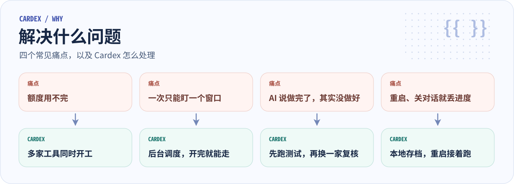

# Cardex

**把你订阅的多家 AI 编程工具组成一支施工队：你定目标、拍板，Cardex 负责拆活、派活、验收、合入。**

**中文** · [English](README.en.md) · [安装](#安装) · [支持的工具](#支持的工具) · [从 V1 升级](docs/v2/upgrade-from-v1.md) · [下载](https://github.com/OttoPrua/Cardex/releases/latest)


## 解决什么问题



调度和看板本身不花模型额度，干活用的是你自己的订阅或 API。

## 特点


- **多工具混用**：Claude Code、Codex、Grok Build、Cursor、Kimi、OpenCode、Antigravity，按难度、能力和余量挑一个；`route explain` 说明为什么选它。
- **小事写卡，大事它拆**：手动目标只跑你加的卡；自动目标先读仓库、做设计、拆卡，方向要你点头才开工。
- **并行不打架**：每张卡在独立工作区里做；改同一函数的自动排队。
- **先测、再复核、再合入**：看实际改动和测试结果，不听口头汇报；代码卡由另一家模型复核。
- **额度不浪费**：快见底就不再派；快重置还有余量，就顺手清积压。
- **该问就问**：需要你定的事一定停下来给选项，沉默不算同意；返工默认最多 2 次，再不行就问你。
- **本地、安全**：数据在本机，代码在 Git；macOS 上执行器跑在系统沙箱里，且推不了代码。

## 工作方式


`cardex serve` 在后台循环：对账 → 给做完的活下结论 → 推进目标 → 合并 → 派新活 → 送出待你拍板的问题。

- **一张卡**：选工具开工 → 验收 → 复核 → 进合并队列；不过就带意见返工。
- **自动目标**：多一层设计循环，方向确认后才拆卡，设计和开发可交错。
- **合并**：同一目标一次合一张，合前再跑测试；有冲突或变红就派人修。进主分支要你同意，不会擅自推远端。
- **容错**：某张卡出错不影响别的；调度重启不打断正在跑的执行器。

<details>
<summary>更多：网页测试、目标模式</summary>

- **网页测试**：需要时 Cardex 在本机启动只监听本机地址的 Chrome 给执行器用，结束后清理。
- **目标模式**：Grok Build、Kimi Code、Cursor 的原生 `/goal` 可以长时间自主推进一张卡，完成后仍走验收、复核、合并。

</details>

## 安装

**推荐**：把这段发给能操作这台电脑的 Codex 或 Hermes 会话。

```text
请在这个对话里帮我安装并配置 Cardex。从 https://github.com/OttoPrua/Cardex/releases/latest 下载
（已下载就从包含 go.mod 的目录继续）。阅读 docs/v2/guide.md 和 skills/cardex-dispatch/SKILL.md；
若这台机器上已有 Cardex V1 数据，先读 docs/v2/upgrade-from-v1.md。然后逐步引导我：
1. 确认管理会话、运行主机和数据目录，安装并运行 doctor。
2. 列出检测到的执行 CLI，问我要接入哪些订阅或 API，在工具内完成认证（不要把密钥发到对话里）。
3. 按我的账户和额度推荐 T1–T3 模型、不同模型族的复核和额度红线，我确认后再保存并重跑 doctor。
4. 推荐手动或自动目标，展示第一张卡和验收方式，我确认后再启动调度。
```

**手动**：从 [Releases](https://github.com/OttoPrua/Cardex/releases/latest) 下载对应平台的包，或从源码构建（Git + Go 1.24+）：

```sh
git clone https://github.com/OttoPrua/Cardex.git && cd Cardex
go build -o ./cardex ./cmd/cardex && ./cardex --home "$HOME/.cardex-demo" doctor
```

首次 `doctor` 提示缺渠道或模型定位是正常的，接着看[第一个目标](#跑通第一个目标)。

| 平台 | 支持情况 |
| --- | --- |
| macOS | 完整支持，执行器在 seatbelt 沙箱里运行 |
| Linux | 可运行，无沙箱 |
| Windows（amd64 / arm64） | 可运行，无沙箱，需要 Git for Windows 的 `sh` |

## 支持的工具

| 执行工具 | runner | 接入方式 |
| --- | --- | --- |
| Claude Code | `claude` | CLI 登录，或 Anthropic Messages 兼容服务 |
| Codex CLI | `codex` | 已登录账户，或 Responses 兼容 provider |
| Grok Build | `grok` | Grok CLI 账户 |
| Cursor Agent | `cursor` | Cursor 账户可用模型 |
| OpenCode | `opencode` | 已配置的 `provider/model` |
| Kimi CLI | `kimi` | Kimi CLI 账户 |
| Antigravity | `agy` | Antigravity CLI |

Cardex 只把模型 ID 交给已登录的工具，不做协议转换。

## 跑通第一个目标


以 Codex 开发、Claude 复核为例：

```sh
export CARDEX_HOME="$HOME/.cardex-demo"
./cardex project add --id demo --repo /path/to/repo --test-cmd 'go test ./...'
./cardex channel set --id my-codex --runner codex --model 'YOUR_AUTHOR_MODEL_ID' --concurrency 1
./cardex channel set --id my-claude --runner claude --model 'YOUR_REVIEW_MODEL_ID' --concurrency 1
./cardex channel check
```

在 `$CARDEX_HOME/config.json` 写入初始模型定位（见下方示例），然后：

```sh
./cardex objective add --id first-change --project demo --mode manual \
  --title '修正导出说明' --origin 'codex:YOUR_THREAD_ID'
./cardex card add --objective first-change --kind dev --tier T2 \
  --title '补齐导出示例' --body '更新导出文档，保留现有行为，并运行项目测试'
./cardex serve --addr 127.0.0.1:0
```

打开 `serve` 打印的地址看进度；排查用 `card show ID` 和 `route explain ID`。

> ⚠️ 看板**没有鉴权**，只绑定本机或 Tailscale 等私有地址，不要用 `0.0.0.0` 暴露到公网。

<details>
<summary>初始模型定位示例</summary>

模型 ID 要和渠道登记的一致。T1 事实核对，T2 常规开发，T3 设计与复核。

```json
{
  "positioning": [
    {"id": "starter-dev", "model": "YOUR_AUTHOR_MODEL_ID", "family": "gpt",
     "tiers": ["T1", "T2"], "capabilities": [], "preference": 1},
    {"id": "starter-review", "model": "YOUR_REVIEW_MODEL_ID", "family": "claude",
     "tiers": ["T3"], "capabilities": [], "preference": 1}
  ]
}
```

之后用 `positioning proposals` / `positioning approve` 更新。

</details>

**文档**：[使用指南](docs/v2/guide.md) · [Agent 派发指引](docs/v2/agent-guide.md) · [设计说明](docs/v2/design.md) · [派发 Skill](skills/cardex-dispatch/SKILL.md) · [从 V1 升级](docs/v2/upgrade-from-v1.md)

## 许可

[PolyForm Noncommercial 1.0.0](LICENSE)：个人、学习研究和非营利机构可直接使用；商业使用请[开 issue](https://github.com/OttoPrua/Cardex/issues) 说明用途获取授权。不是 OSI 开源许可；2026-08-03 前的版本（截至 `b1ed92b`）仍为 MIT。

## 致谢

本项目在 [LINUX DO](https://linux.do) 社区分享，感谢佬友们的反馈。
